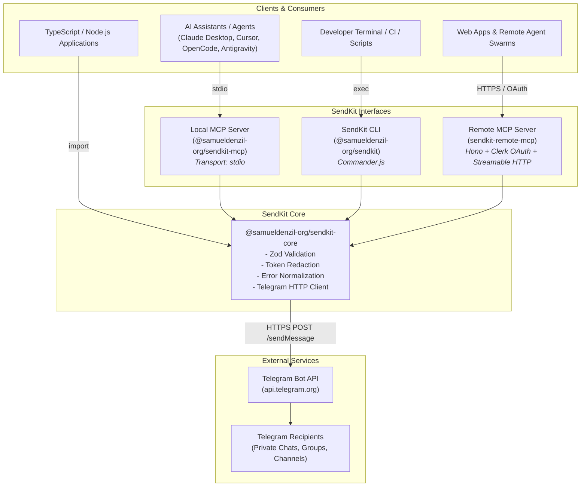

# SendKit

<div align="center">

[](https://www.typescriptlang.org/)
[](https://bun.sh/)
[](https://nodejs.org/)
[](https://modelcontextprotocol.io/)
[](https://oxc.rs/)
[](https://oxc.rs/)
[](https://clerk.com/)

**The messaging toolkit for AI agents, automation pipelines, and developers.**  
_Deliver messages across communication channels with native Model Context Protocol (MCP) servers, a dedicated CLI, and a type-safe TypeScript SDK._

[Features](#key-features) • [Architecture](#architecture) • [Packages](#monorepo-packages) • [Quick Start](#quick-start) • [MCP Setup](#mcp-server-integration) • [CLI](#sendkit-cli) • [Remote Server](#remote-mcp-server-appsremote-mcp) • [SDK](#core-sdk-programmatic-usage) • [Contributing](#contributing)

</div>

---

## Overview

**SendKit** bridges the gap between AI agents, developer tooling, and modern messaging platforms, starting with **Telegram**. Rather than hardcoding bespoke Telegram HTTP requests or juggling insecure credentials across agent prompts, SendKit provides a modular, production-ready ecosystem:

- **Local MCP Server (`stdio`)**: Gives AI coding assistants (Claude Desktop, Cursor, OpenCode, Antigravity) native, zero-overhead tool access to send Telegram messages.
- **Remote MCP Server (`HTTP/SSE`)**: Enterprise-ready, hosted Streamable HTTP MCP service with Clerk OAuth authentication and RFC 9728 Protected Resource Metadata.
- **Developer CLI**: Fast terminal command (`sendkit telegram`) and secure credential manager (`sendkit init`) for manual testing, shell scripts, and fallback dispatches.
- **Core SDK**: Zero-dependency, type-safe runtime library with Zod schema validation and automatic token redaction.

---

## Key Features

- 🤖 **Agent-First MCP Tooling**: Exposes standard MCP tool definitions (`send_telegram_message`) enabling language models to dispatch formatted messages directly from their execution loops.
- 🔒 **Zero-Leak Security & Automatic Redaction**: Automatically catches and redacts Telegram bot tokens matching patterns or explicit inputs from error messages, URLs, and stack traces (`[REDACTED]`).
- 📁 **Secure POSIX Credential Storage**: CLI stores authentication tokens locally at `~/.config/sendkit/config.json` with strict `0o600` file permissions and `0o700` parent directory permissions.
- 🌐 **Remote MCP with Clerk OAuth & RFC 9728**: Production-grade HTTP/SSE server built on Hono and `@clerk/mcp-tools`, supporting multi-tenant bot tokens via URL path (`/:botToken/mcp`), custom headers (`X-Telegram-Bot-Token`), or environment variables.
- 🛡️ **Comprehensive Validation**: Strict Zod schemas enforce Telegram constraints, including recipient chat ID formats, non-empty text, and the Telegram API maximum length of 4,096 characters.
- ⚡ **Ultra-Fast Rust Tooling**: Workspace orchestrated with Bun workspaces, bundled via `tsdown` (powered by Rolldown v1.3), linted with `oxlint`, and formatted with `oxfmt`.

---

## Architecture



---

## Monorepo Packages

The repository is structured as a Bun monorepo comprising three published/publishable packages and one deployment service:

| Package / App                        | Path                                       | Type        | Description                                                                                |
| :----------------------------------- | :----------------------------------------- | :---------- | :----------------------------------------------------------------------------------------- |
| **`@samueldenzil-org/sendkit-core`** | [`packages/core`](packages/core)           | Library     | Shared core logic: Telegram API client, Zod schemas, token redaction, and error utilities. |
| **`@samueldenzil-org/sendkit`**      | [`packages/cli`](packages/cli)             | CLI Binary  | Command-line interface with `init` and `telegram` commands.                                |
| **`@samueldenzil-org/sendkit-mcp`**  | [`packages/local-mcp`](packages/local-mcp) | MCP Server  | Standard I/O (`stdio`) MCP server exposing `send_telegram_message`.                        |
| **`sendkit-remote-mcp`**             | [`apps/remote-mcp`](apps/remote-mcp)       | Web Service | Hosted HTTP MCP server with Clerk OAuth authentication and RFC 9728 discovery.             |
| **`sendkit` (Skill)**                | [`skills/sendkit`](skills/sendkit)         | Agent Skill | Agent skill documentation for MCP vs CLI workflow routing and troubleshooting.             |

---

## Prerequisites & Telegram Setup

Before sending messages, obtain a Telegram Bot Token and verify your recipient chat accessibility:

### 1. Create a Bot and Get a Token

1. Open Telegram and search for [@BotFather](https://t.me/botfather).
2. Send `/newbot` and follow the prompts to choose a bot name and username.
3. Copy the HTTP API token provided (e.g., `123456789:ABCdefGhIJKlmNoPQRsTUVwxyZ`).

### 2. Prepare the Target Chat

Telegram bots **cannot initiate unsolicited conversations**. Ensure permissions match your target chat type:

- **Direct User Message (DM)**: The recipient user must open your bot in Telegram and click **Start** (`/start`).
- **Groups & Supergroups**: Add your bot as a member. If permissions are restricted, promote the bot to Administrator with the **Post Messages** permission.
- **Channels**: Add the bot as an Administrator with the **Post Messages** permission.

### Chat ID Format Reference

- **User ID**: Positive integer string (e.g., `"123456789"`).
- **Group ID**: Negative integer string (e.g., `"-987654321"`).
- **Supergroup / Channel ID**: Negative integer string prefixed with `-100` (e.g., `"-1001234567890"`).
- **Public Channel Username**: Username prefixed with `@` (e.g., `"@mychannel"`).

---

## Quick Start

You can run SendKit instantly without cloning the repository via `npx`:

```bash
# 1. Initialize credentials locally
npx @samueldenzil-org/sendkit init --telegram-bot-token "<your_bot_token>"

# 2. Send a test message
npx @samueldenzil-org/sendkit telegram "<chatId>" "Hello from SendKit!"
```

---

## MCP Server Integration

The local MCP server (`@samueldenzil-org/sendkit-mcp`) allows any MCP-compatible AI assistant to call `send_telegram_message`.

### Tool Specification: `send_telegram_message`

| Parameter | Type     | Required | Description                                                          |
| :-------- | :------- | :------- | :------------------------------------------------------------------- |
| `chatId`  | `string` | **Yes**  | Destination numeric user ID, group ID, or public `@channelusername`. |
| `message` | `string` | **Yes**  | Message body text (1 to 4,096 characters).                           |

#### Structured Output

```json
{
  "ok": true,
  "chatId": "123456789",
  "messageId": 1042
}
```

---

### Client Configuration Guides

#### 1. Claude Desktop

Add SendKit to your `claude_desktop_config.json`:

- **macOS**: `~/Library/Application Support/Claude/claude_desktop_config.json`
- **Windows**: `%APPDATA%\Claude\claude_desktop_config.json`

```json
{
  "mcpServers": {
    "sendkit": {
      "command": "npx",
      "args": ["-y", "@samueldenzil-org/sendkit-mcp"],
      "env": {
        "TELEGRAM_BOT_TOKEN": "<your_bot_token>"
      }
    }
  }
}
```

#### 2. Cursor

Add to `.cursor/mcp.json` or global Cursor MCP settings:

```json
{
  "mcpServers": {
    "sendkit": {
      "command": "npx",
      "args": ["-y", "@samueldenzil-org/sendkit-mcp"],
      "env": {
        "TELEGRAM_BOT_TOKEN": "<your_bot_token>"
      }
    }
  }
}
```

#### 3. OpenCode

Add to `opencode.json`:

```json
{
  "$schema": "https://opencode.ai/config.json",
  "mcp": {
    "sendkit": {
      "type": "stdio",
      "command": ["npx", "-y", "@samueldenzil-org/sendkit-mcp"],
      "environment": {
        "TELEGRAM_BOT_TOKEN": "<your_bot_token>"
      },
      "enabled": true
    }
  }
}
```

#### 4. Generic / Standard MCP Client (`.mcp.json`)

```json
{
  "mcpServers": {
    "sendkit": {
      "type": "stdio",
      "command": "npx",
      "args": ["-y", "@samueldenzil-org/sendkit-mcp"],
      "env": {
        "TELEGRAM_BOT_TOKEN": "<your_bot_token>"
      }
    }
  }
}
```

---

## SendKit CLI

The CLI is designed for standalone developer workflows, automated terminal scripts, and fallback execution when an MCP daemon is unavailable.

### Global Installation

```bash
npm install -g @samueldenzil-org/sendkit
# or
bun add -g @samueldenzil-org/sendkit
```

### Commands

#### `sendkit init`

Initializes and securely stores your Telegram Bot token in `~/.config/sendkit/config.json` with restricted `0o600` permissions.

```bash
sendkit init --telegram-bot-token "<your_bot_token>"
```

#### `sendkit telegram <chatId> <message>`

Sends a message to the specified chat ID using credentials stored during `init`.

```bash
sendkit telegram "123456789" "Deployment v1.4.0 passed smoke tests."
```

Output:

```json
{ "ok": true, "chatId": "123456789", "messageId": 1043 }
```

---

## Remote MCP Server (`apps/remote-mcp`)

The remote MCP app provides a production-grade, multi-tenant HTTP MCP endpoint with OAuth authorization via [Clerk](https://clerk.com).

### Endpoints

| Method | Endpoint                                              | Description                                                      | Auth Required      |
| :----- | :---------------------------------------------------- | :--------------------------------------------------------------- | :----------------- |
| `GET`  | `/.well-known/oauth-protected-resource/mcp`           | RFC 9728 Protected Resource Metadata for default endpoint.       | No                 |
| `GET`  | `/.well-known/oauth-protected-resource/:botToken/mcp` | RFC 9728 Protected Resource Metadata for dynamic token endpoint. | No                 |
| `ALL`  | `/mcp`                                                | MCP Streamable HTTP transport endpoint.                          | Yes (Clerk Bearer) |
| `ALL`  | `/:botToken/mcp`                                      | Multi-tenant MCP transport endpoint parameterized by bot token.  | Yes (Clerk Bearer) |

### Bot Token Resolution Precedence

The server dynamically resolves the Telegram bot token in the following order:

1. `X-Telegram-Bot-Token` HTTP request header
2. `/:botToken/mcp` URL path parameter
3. `TELEGRAM_BOT_TOKEN` server environment variable

### Running Locally

```bash
# 1. Set required environment variables
export CLERK_PUBLISHABLE_KEY="pk_test_..."
export CLERK_SECRET_KEY="sk_test_..."
export TELEGRAM_BOT_TOKEN="123456789:ABC..." # Optional fallback

# 2. Start the HTTP server (defaults to port 3000)
bun run dev:remote-mcp
```

### Deploying to Production (Render / Cloud)

The app is fully compatible with cloud platforms like Render, Railway, and Fly.io:

- **Runtime**: Bun (`bun run src/index.ts`)
- **Build Command**: `echo 'No build step required for Bun'`
- **Start Command**: `bun run src/index.ts`
- **Reverse Proxy Support**: Built-in support for `X-Forwarded-Proto` and `X-Forwarded-Host` ensures correct resource metadata URLs when behind proxies or load balancers.

---

## Core SDK Programmatic Usage

You can import `@samueldenzil-org/sendkit-core` directly into any Node.js, Bun, or TypeScript backend.

### Installation

```bash
bun add @samueldenzil-org/sendkit-core
# or
npm install @samueldenzil-org/sendkit-core
```

### Example Usage

```typescript
import {
  sendTelegramMessage,
  getErrorMessage,
  MAX_TELEGRAM_MESSAGE_LENGTH,
} from "@samueldenzil-org/sendkit-core";

async function notifyAdmin() {
  try {
    const result = await sendTelegramMessage({
      botToken: process.env.TELEGRAM_BOT_TOKEN!,
      chatId: "123456789",
      message: "Server load exceeded 85% threshold.",
    });

    console.log(`Delivered message ID: ${result.messageId}`);
  } catch (error) {
    // getErrorMessage automatically suppresses and redacts any bot token
    console.error("Failed to send notification:", getErrorMessage(error));
  }
}
```

---

## Environment Variables & Configuration

| Variable                | Scope                          | Required              | Description                                                                                     |
| :---------------------- | :----------------------------- | :-------------------- | :---------------------------------------------------------------------------------------------- |
| `TELEGRAM_BOT_TOKEN`    | Local MCP / CLI / Remote MCP   | Conditional           | Telegram Bot token from `@BotFather`. Required for Local MCP. Optional fallback for Remote MCP. |
| `CLERK_PUBLISHABLE_KEY` | Remote MCP (`apps/remote-mcp`) | **Yes** (Remote only) | Clerk frontend API publishable key.                                                             |
| `CLERK_SECRET_KEY`      | Remote MCP (`apps/remote-mcp`) | **Yes** (Remote only) | Clerk backend secret key for validating OAuth tokens.                                           |
| `PORT`                  | Remote MCP (`apps/remote-mcp`) | No (default: `3000`)  | Listening port for the Hono HTTP server.                                                        |

### Configuration Files

- **CLI Local Config**: `~/.config/sendkit/config.json` (created automatically by `sendkit init`).
- **Workspace Config**: `.env` (loaded during local testing; use `.env.example` as a template).

---

## Project Directory Structure

```text
sendkit/
├── .agents/
│   └── plugins/sendkit/        # Antigravity plugin definition and MCP config
├── .cursor/
│   └── mcp.json                # Cursor workspace MCP server configuration
├── apps/
│   └── remote-mcp/             # Hosted Streamable HTTP MCP server (Hono + Clerk)
│       ├── src/
│       │   └── index.ts        # Server entrypoint with OAuth & RFC 9728 endpoints
│       └── package.json
├── packages/
│   ├── cli/                    # SendKit command-line tool
│   │   ├── src/
│   │   │   └── index.ts        # Commander.js CLI implementation
│   │   ├── package.json
│   │   └── tsdown.config.ts    # Bundling configuration
│   ├── core/                   # Shared TypeScript library
│   │   ├── src/
│   │   │   ├── constants.ts    # Constants (e.g. 4096 char limit)
│   │   │   ├── errors.ts       # Token redaction & error unwrapping
│   │   │   ├── index.ts        # Public exports
│   │   │   ├── operations.ts   # HTTP dispatch logic
│   │   │   └── schemas.ts      # Zod validation schemas
│   │   ├── package.json
│   │   └── tsdown.config.ts
│   └── local-mcp/              # Local stdio MCP server
│       ├── src/
│       │   └── index.ts        # StdioServerTransport & tool registration
│       ├── package.json
│       └── tsdown.config.ts
├── skills/
│   └── sendkit/
│       └── SKILL.md            # Agent skill instructions & workflow matrix
├── .env.example                # Template for environment variables
├── .mcp.json                   # Standard workspace MCP definition
├── .oxfmtrc.json               # oxfmt code formatter configuration
├── .oxlintrc.json              # oxlint linter configuration
├── bun.lock                    # Bun lockfile
├── opencode.json               # OpenCode MCP configuration
├── package.json                # Monorepo root configuration & scripts
└── tsconfig.json               # Base TypeScript configuration
```

---

## Development Workflow

### Prerequisites

- [Bun](https://bun.sh/) v1.2+ installed
- Node.js v20+ (optional, for compatibility verification)

### Setup

Clone the repository and install all workspace dependencies:

```bash
git clone https://github.com/samueldenzil/sendkit.git
cd sendkit
bun install
```

### Available Scripts

| Command                          | Action                                                             |
| :------------------------------- | :----------------------------------------------------------------- |
| `bun run build`                  | Builds all packages (`core`, `local-mcp`, `cli`) via `tsdown`.     |
| `bun run build:core`             | Builds `@samueldenzil-org/sendkit-core`.                           |
| `bun run build:cli`              | Builds `@samueldenzil-org/sendkit`.                                |
| `bun run build:local-mcp`        | Builds `@samueldenzil-org/sendkit-mcp`.                            |
| `bun run dev:cli`                | Runs the CLI directly from source (`packages/cli/src/index.ts`).   |
| `bun run dev:local-mcp`          | Runs the local stdio MCP server from source.                       |
| `bun run dev:remote-mcp`         | Starts the remote HTTP MCP server from source.                     |
| `bun run lint`                   | Runs `oxlint` with `--deny-warnings` across the monorepo.          |
| `bun run lint:fix`               | Automatically fixes autofixable `oxlint` issues.                   |
| `bun run format:check`           | Checks formatting compliance with `oxfmt`.                         |
| `bun run format`                 | Formats all source files with `oxfmt --write`.                     |
| `bun run typecheck`              | Validates TypeScript types across the monorepo via `tsc --noEmit`. |
| `bun run release:pack:core`      | Builds and dry-run packs `@samueldenzil-org/sendkit-core`.         |
| `bun run release:pack:cli`       | Builds and dry-run packs `@samueldenzil-org/sendkit`.              |
| `bun run release:pack:local-mcp` | Builds and dry-run packs `@samueldenzil-org/sendkit-mcp`.          |

---

## Troubleshooting & Common Issues

| Symptom / Error Message                                            | Root Cause                                                                                 | Solution                                                                                                            |
| :----------------------------------------------------------------- | :----------------------------------------------------------------------------------------- | :------------------------------------------------------------------------------------------------------------------ |
| `TELEGRAM_BOT_TOKEN environment variable is required`              | The local MCP server process was launched without `TELEGRAM_BOT_TOKEN` in its environment. | Add `TELEGRAM_BOT_TOKEN` under `env` in your client config (`.mcp.json`, Claude, or Cursor) and restart the client. |
| `No Telegram Bot token configured. Run sendkit init...`            | The CLI config file (`~/.config/sendkit/config.json`) does not exist or has no token.      | Run `sendkit init --telegram-bot-token <your_bot_token>` to save your credentials.                                  |
| `Telegram API error: [400] Bad Request: chat not found`            | The target `chatId` does not exist or the user has not started the bot.                    | Ensure the recipient clicked **Start** (`/start`) in the bot, or check the group/channel ID.                        |
| `Telegram API error: [403] Forbidden: bot was blocked by the user` | The user blocked the bot, or the bot was removed from the group/channel.                   | Have the user unblock the bot or re-add the bot as a group/channel member.                                          |
| `Message exceeds Telegram's limit of 4096 characters`              | The text body exceeds the Telegram limit.                                                  | Truncate or split the message into chunks before sending.                                                           |
| Sensitive token appears as `[REDACTED]` in logs                    | Expected security behavior.                                                                | SendKit intentionally scrubs secret tokens to prevent accidental log leaks.                                         |

---

## Security Considerations

1. **Token Redaction**: SendKit incorporates custom token masking logic in `packages/core/src/errors.ts`. Any token matching the Telegram Bot token format (`\d{6,}:[A-Za-z0-9_-]{20,}`) or explicitly supplied during operation is purged before error messages reach the user, logs, or agent transcripts.
2. **Local Credential Permissions**: The CLI writes configuration with POSIX `0o600` (read/write only for owner) and sets the parent directory to `0o700`.
3. **OAuth Boundary for Remote MCP**: The hosted server strictly enforces Clerk OAuth Bearer token validation for all MCP endpoints. Unauthenticated requests are rejected with `401 Unauthorized` and provide RFC 9728 discovery headers.

---

## Contributing

Contributions are welcome! Please follow these steps:

1. Fork the repository and create a feature branch (`git checkout -b feature/my-feature`).
2. Implement your changes following the existing code structure.
3. Ensure formatting and lint checks pass cleanly:
   ```bash
   bun run format:check
   bun run lint
   bun run typecheck
   bun run build
   ```
4. Commit your changes with conventional commit messages (`feat: ...`, `fix: ...`).
5. Open a Pull Request against `main`.
